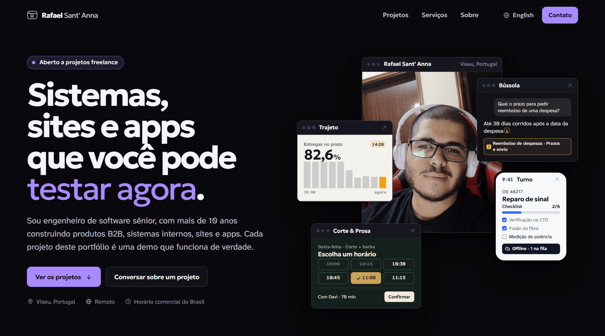

# Rafael Sant' Anna

Engenheiro de software sênior. Construo sistemas B2B, sites e apps, da interface à regra de negócio. São mais de 10 anos em produção, de painéis administrativos a plataformas com milhares de usuários.

Hoje sou Desenvolvedor Full Stack Sênior na Fundacred. Moro em Viseu, Portugal, trabalho no horário comercial do Brasil e **estou aberto a projetos freelance.**

[Portfólio](https://rafaelsantanna.github.io/) · [LinkedIn](https://www.linkedin.com/in/devrafaelsantanna/) · [Email](mailto:dev.rafaelsilva@gmail.com) · [CV em PDF](https://rafaelsantanna.github.io/cv/rafael-sant-anna-cv.pdf) · [English](https://rafaelsantanna.github.io/en/)

## Projetos para abrir e usar agora

Demos que eu construí do zero, com marca e dados fictícios. Tudo roda no navegador.

<table>
  <tr>
    <td width="50%" valign="top">
      
      <h3>Trajeto</h3>
      Torre de controle de entregas: tabela com filtros, perfis de acesso, ações com desfazer e paleta de comandos. 
      <a href="https://rafaelsantanna.github.io/demos/logistics-control/">Abrir a demo</a> · <a href="https://rafaelsantanna.github.io/work/logistics-control/">Sobre o projeto</a>
    </td>
    <td width="50%" valign="top">
      
      <h3>Ventura</h3>
      Modernização de backoffice: a tela antiga e a nova lado a lado, usando o mesmo módulo de regras de negócio. 
      <a href="https://rafaelsantanna.github.io/demos/legacy-modernization/">Abrir a demo</a> · <a href="https://rafaelsantanna.github.io/work/legacy-modernization/">Sobre o projeto</a>
    </td>
  </tr>
  <tr>
    <td width="50%" valign="top">
      
      <h3>Bússola</h3>
      Assistente de conhecimento com busca BM25 no navegador: responde citando a fonte e encaminha para uma pessoa quando não tem base. 
      <a href="https://rafaelsantanna.github.io/demos/knowledge-assistant/">Abrir a demo</a> · <a href="https://rafaelsantanna.github.io/work/knowledge-assistant/">Sobre o projeto</a>
    </td>
    <td width="50%" valign="top">
      
      <h3>Corte &amp; Prosa</h3>
      Site de barbearia com agendamento que calcula os horários livres de cada profissional, mais a agenda do lado da barbearia. 
      <a href="https://rafaelsantanna.github.io/demos/online-booking/">Abrir a demo</a> · <a href="https://rafaelsantanna.github.io/work/online-booking/">Sobre o projeto</a>
    </td>
  </tr>
  <tr>
    <td width="50%" valign="top">
      
      <h3>Turno</h3>
      App para técnicos de campo que continua funcionando sem sinal, com checklist, assinatura e fila de sincronização. 
      <a href="https://rafaelsantanna.github.io/demos/field-service-app/">Abrir a demo</a> · <a href="https://rafaelsantanna.github.io/work/field-service-app/">Sobre o projeto</a>
    </td>
    <td width="50%" valign="top">
      <h3>Landing pages</h3>
      Duas páginas comerciais com direção de arte própria:  
      <a href="https://rafaelsantanna.github.io/demos/pousada-boutique/">Casa Neblina</a>, pousada na serra com planejador de estadia. 
      <a href="https://rafaelsantanna.github.io/demos/climatizacao-local/">Clima Certa</a>, climatização com pedido de orçamento guiado.  
      <a href="https://rafaelsantanna.github.io/work/">Ver todos os projetos</a>
    </td>
  </tr>
</table>

## Experiência

| Período | Onde | O que fiz |
| --- | --- | --- |
| 2026 até hoje | Fundacred | Desenvolvimento e evolução de aplicações web, com participação em decisões de arquitetura de software e na implementação de soluções com IA. |
| 2025 a 2026 | Affinity / Axians | Plataforma acadêmica com React 19 e Laravel 11. Mais de 200 melhorias e funcionalidades num projeto previsto para mais de um ano, entregue em cerca de seis meses. |
| 2019 a 2025 | Revvo | Mais de 15 projetos LMS/LXP corporativos, integrações com ERP, CRM e BI, e participação na assistente de IA JUDY. |
| 2017 a 2019 | Trinks | Interfaces administrativas e agendamento online para salões, clínicas, redes e franquias. |
| 2014 a 2017 | aspecTI | Sistemas empresariais, incluindo uma plataforma do Grupo Profarma com mais de 10.000 usuários. |
| Produto próprio | EdgeData | Inventário, sessões SSH e Telnet e automação para equipes de infraestrutura de rede. |

## Stack

Também trabalho com React Native, APIs REST, RAG e automações com IA, bots para WhatsApp e Telegram.
